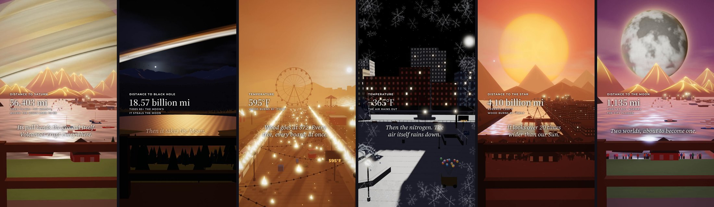

# What-if videos

A [Claude](https://claude.com) skill and a standalone Python renderer for 65-second vertical
**"What if…?" videos**: *What if Saturn crashed into Earth? What if a black hole swallowed us?
What if it got 10 degrees colder every second?*



Each video is one locked shot of a calm place on Earth while something changes, and everything
on screen follows from real numbers: the body's distance, its tides, when it steals the Moon, when
the sea floods, the temperature at which water boils, paper ignites or oxygen turns to liquid.
Text carries the story (no voice-over), with a synthesized ambient soundtrack that follows the action.

- **Low-poly 3D**, rendered headless with OpenGL (moderngl). Works on a GPU, or on a CPU through Mesa.
- **1080×1920, 30 fps, 65 s, under 20 MB**, ready for TikTok, YouTube Shorts and Reels.
- **Five story modes:** impact, flyby, strike (a comet hits within sight), escape (Earth flung out of
  the galaxy) and temperature (the air heats or cools every second, or the Sun goes out).
- **Five scenes:** a dusk harbor, a golden-hour forest valley, a sunset carnival boardwalk, a riverside
  city plaza and a tropical beach (with a tsunami), each with crowds, lights and effects keyed to the physics.
  A lakeside template and a scene lab (beach, ski village, desert prototypes) give new scenes a head start.
- **22 ready-made scenarios**, from Saturn, Jupiter, Venus and the Moon to a pulsar, a white dwarf, the
  dinosaur-killing asteroid, a supermassive black hole, the red supergiant Stephenson 2-18, and "the Sun goes out".
- **Scenarios are YAML.** Most new videos are a new entry, with no code.

## Quick start

```bash
pip install moderngl numpy pillow pyyaml          # Python 3.10+
# plus ffmpeg, and on headless Linux: apt-get install -y libegl1 libgl1-mesa-dri

cd whatif-videos/scripts
python3 whatif_cli.py list                                   # the catalog
python3 whatif_cli.py check saturn-crash                     # beat sheet + timing warnings
python3 whatif_cli.py stills saturn-crash 5 30 50 --sheet sheet.png   # a few frames, fast
python3 whatif_cli.py render saturn-crash --out saturn.mp4  # the full video with sound
python3 whatif_cli.py sheet saturn.mp4                       # QA grid before you post
python3 whatif_cli.py caption saturn-crash                   # a ready-to-post caption
python3 whatif_cli.py new-scene rooftop                      # start a new scene from the template
```

A render takes about a minute on a GPU (add `--quality high` for supersampling) and about 8–11 minutes
on a 4-core CPU. On Windows, put ffmpeg on PATH, skip the apt line (your GPU driver provides OpenGL) and
set `PYTHONIOENCODING=utf-8`, since captions contain emoji.

## Use it as a Claude skill

The `whatif-videos/` folder is a complete [Agent Skill](https://docs.claude.com/en/docs/agents-and-tools/agent-skills/overview):
`SKILL.md` teaches Claude the workflow, the house style and the physics, and the references cover
writing scenarios, extending the engine and posting strategy.

- **Claude Code:** copy the folder to `~/.claude/skills/whatif-videos` (all projects) or to
  `.claude/skills/whatif-videos` in a repository. Then ask for "a what if video about Venus crashing
  into Earth".
- **Claude apps:** zip the folder and upload it where your plan allows custom skills.

## Write your own scenario

Copy the closest entry in `whatif-videos/scripts/whatif/scenarios.yaml`, or put new entries in your
own file and pass `--catalog mine.yaml`. Beats pin to times, distances, tide strengths, temperatures
or physical events:

```yaml
- id: mars-crash
  title: What if Mars crashed into Earth?
  hook: "What if {Mars} crashed into Earth?"     # {braces} = accent color
  scene: harbor
  body: {name: Mars, radius_mi: 2106, mass_earths: 0.107, start_mi: 34600000, surface: rocky}
  hud_label: DISTANCE TO MARS
  impact_s: 57
  beats:
    - {at_s: 3.8, line: "That red dot is Mars. It's heading straight for us."}
    - {gap_mi: 34600000, label: AS CLOSE AS IT EVER GETS}
    - {tide: 1, label: TIDES AS STRONG AS THE MOON'S}
    - {event: impact, label: IMPACT}
  ...
```

See [`references/scenario-authoring.md`](whatif-videos/references/scenario-authoring.md) for every
field, the physics formulas and a fact sheet, [`references/scenes.md`](whatif-videos/references/scenes.md)
for building a new scene, and [`references/engine.md`](whatif-videos/references/engine.md) to add a new
kind of body or effect.

## Tests

```bash
cd whatif-videos/scripts && python3 -m pytest -q ../tests
```

## Credits

- Fonts: [Source Serif 4](https://github.com/adobe-fonts/source-serif) (Adobe) and
  [Montserrat](https://github.com/JulietaUla/Montserrat), both under the SIL Open Font License;
  their licenses are in `whatif-videos/assets/fonts/`.
- Planet data: NASA planetary fact sheets. Thresholds and records are cited in the scenario comments.

## License

MIT; see [LICENSE](LICENSE). The bundled fonts keep their own OFL licenses.
